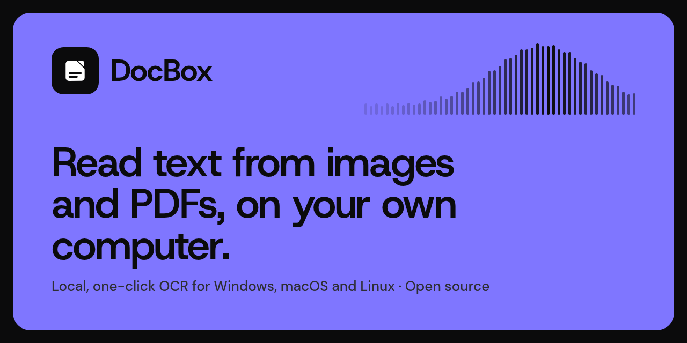

  

We build **[DocBox](https://github.com/docboxai/docbox-app)**, a desktop app for Windows,
macOS and Linux that reads text from images and PDFs on your own computer. Pick an OCR model and
DocBox sets everything up for you: no account, no cloud.

- **Local by default.** Your documents stay on your computer unless you switch on the
  optional NVIDIA cloud engine.
- **One click to set up.** DocBox checks your memory and disk, recommends the best model
  for your computer, and installs its engine and model files for you.
- **Many engines.** PaddleOCR, Tesseract, EasyOCR and local AI vision models through Ollama.
- **Whole files.** Every page of a PDF or TIFF, saved as text, Markdown, JSON or a
  searchable PDF.

  <a href="https://github.com/docboxai/docbox-app/releases/latest"><b>Download DocBox</b></a> ·
  <a href="https://github.com/docboxai/docbox-app#tutorial">Tutorial</a> ·
  <a href="https://github.com/docboxai/docbox-app#development">Contribute</a>

DocBox is open source under the Apache 2.0 license, made by the DocBox AI team (Pranav and Pawan).
